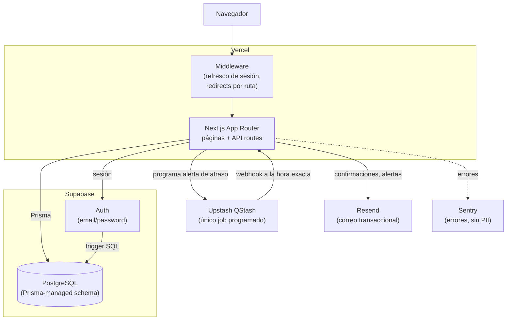
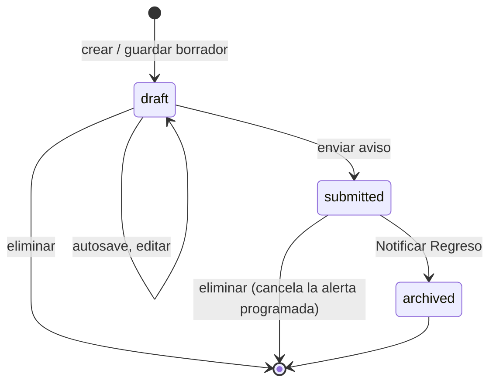
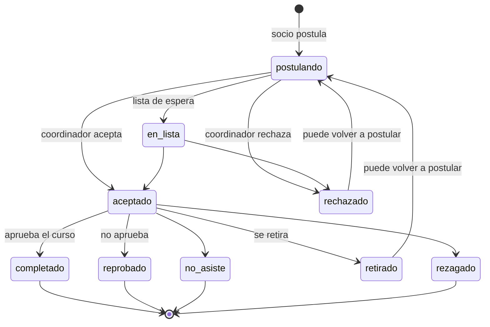
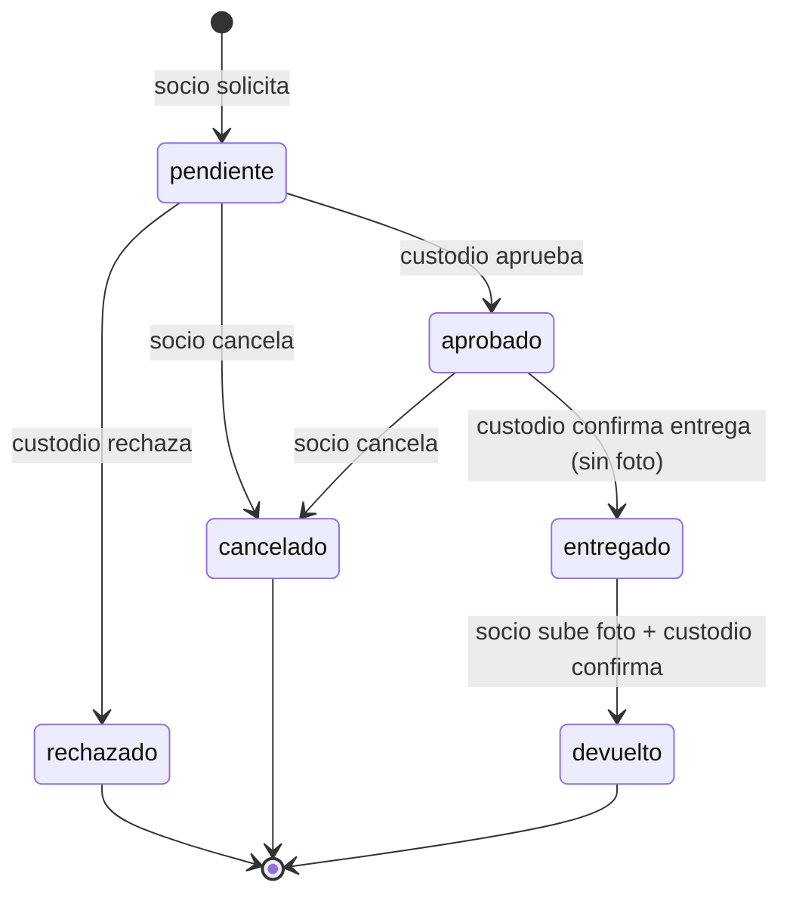
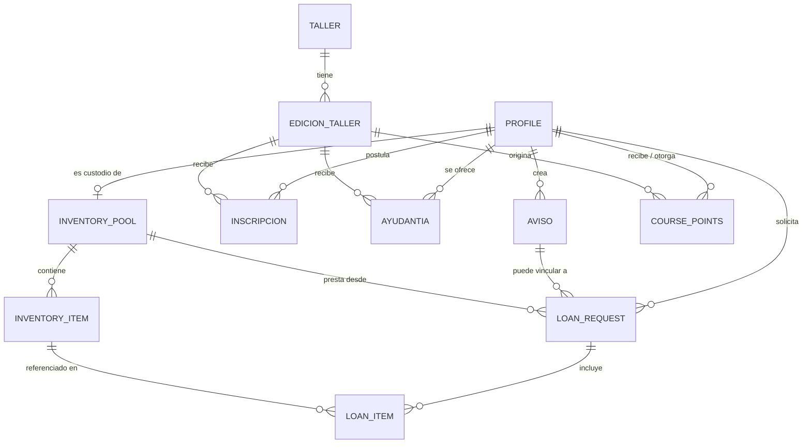

# CAU Avisos

> **🚧 Active development.** Internal tool built for a single club (Club Andino Universitario). Treat the code as a working draft rather than a finished product — see [Status & Known Limitations](#status--known-limitations).

Web app for the **Club Andino Universitario (CAU)** to manage "avisos de salida" (mountain expedition safety notices), course/taller enrollment, and equipment lending. An aviso de salida records who's going where, the itinerary, risk assessment, equipment, and emergency contacts for a mountaineering trip, so a designated contact can trigger a rescue protocol if the group doesn't check back in on time.

## Table of Contents

1. [Status & Known Limitations](#status--known-limitations)
2. [Architecture & Stack](#architecture--stack)
   - [Architecture diagram](#architecture-diagram)
   - [Design principles](#design-principles)
   - [Project structure](#project-structure)
3. [Actors & Roles](#actors--roles)
4. [Features](#features)
   - [4.1 Auth, Registration & Membership](#41-auth-registration--membership)
   - [4.2 Avisos de Salida](#42-avisos-de-salida)
   - [4.3 Cursos y Talleres](#43-cursos-y-talleres)
   - [4.4 Préstamos — Equipo Club](#44-préstamos--equipo-club)
   - [4.5 Admin Panel](#45-admin-panel)
   - [4.6 Dashboard & Perfil](#46-dashboard--perfil)
5. [Data Model](#data-model)
   - [Entity relationships](#entity-relationships)
   - [Model index](#model-index)
6. [Infrastructure & Operations](#infrastructure--operations)
   - [6.1 Testing](#61-testing)
   - [6.2 CI/CD](#62-cicd)
   - [6.3 Error tracking (Sentry)](#63-error-tracking-sentry)
   - [6.4 Scheduled jobs (QStash)](#64-scheduled-jobs-qstash)
   - [6.5 Email (Resend)](#65-email-resend)
   - [6.6 Database migrations](#66-database-migrations)
7. [Local Development](#local-development)

---

## Status & Known Limitations

- **Data model is still shifting.** The Prisma schema has gone through several redesigns and will likely keep changing.
- **Real member data lives outside the repo.** The `db:seed` script expects a real member whitelist and inventory data locally (see [Local Development](#local-development)) — none is committed, by design.
- **Authorization is mostly role-checks in API routes**, not a formal policy layer. Supabase RLS is used for some tables (see `supabase/migrations/`) but not uniformly.
- **Admin panels are functional but minimal** — little validation UX, no audit log of who changed what.
- **Single club, hardcoded assumptions.** Spanish-only UI, Chilean RUT format, and CAU-specific protocols/roles are baked into the domain model rather than configurable.
- **Test coverage is targeted, not exhaustive.** Vitest covers the riskiest business logic (API route handlers, pure helper functions) by mocking Prisma/Supabase — there's no component, UI, or end-to-end test suite. See [Testing](#61-testing).
- **The overdue-return alert is the only scheduled job.** Everything else in the app is computed on read — see [Design principles](#design-principles) and [Scheduled jobs (QStash)](#64-scheduled-jobs-qstash).

---

## Architecture & Stack

- **Framework**: [Next.js 15](https://nextjs.org/) (App Router) + React 19, TypeScript
- **Styling**: Tailwind CSS 4
- **Database**: PostgreSQL via [Prisma ORM](https://www.prisma.io/) (`prisma/schema.prisma`) for application data
- **Auth & platform**: [Supabase](https://supabase.com/) — Auth (email/password + whitelist trigger) and Postgres hosting; some tables also carry Supabase Row Level Security policies (`supabase/migrations/`) alongside the Prisma-managed schema
- **Email**: [Resend](https://resend.com/) for transactional email
- **Scheduled jobs**: [Upstash QStash](https://upstash.com/docs/qstash) for the one job this app needs
- **Error tracking**: [Sentry](https://sentry.io/) (`@sentry/nextjs`)
- **Testing**: [Vitest](https://vitest.dev/)
- **Deployment**: Vercel
- **CI**: GitHub Actions — type-check, lint, test, and build on every push/PR to `main` (`.github/workflows/ci.yml`)

### Architecture diagram



### Design principles

A few decisions repeat across unrelated features — worth naming once instead of re-discovering per feature:

- **Computed on read, never cached.** Equipment availability, membership status ("vigente"/"vencida"), and a loan's "atrasado" (overdue) badge are all derived at query/render time from real rows (loan statuses, dates), never stored as a separately-maintained number or boolean. This was the explicit fix for the old equipment spreadsheet's manually-edited "Disponibles" column, which drifted from reality constantly — and the same principle was then applied everywhere else a similar derived value shows up.
- **Role hierarchy, not role lists.** Every permission check is "does this profile have role X, or is it `admin`?" — `admin` never needs to be enumerated alongside every other role explicitly; it's a universal fallback.
- **Two aviso flows calibrated to risk, not one generic form.** Aviso Largo's five-step form (itinerary, risk assumptions, equipment, InReach tracking) is built for multi-day expeditions where that detail matters for a rescue. Aviso Rápido deliberately skips all of it for a same-day outing, trading thoroughness for speed — these aren't the same form with optional sections, they're two different documents.
- **The photo is required where it's actually useful, not symmetrically.** A custodio confirms pickup with one click, no photo — but a borrower must upload a return photo before the custodio can close the loan. The only moment worth documenting is the equipment's condition *coming back*, not going out.
- **One scheduled job, deliberately.** Everything else in this app reacts to a request; nothing else runs on a timer. The aviso overdue-alert is the sole exception, because "nobody checked in by the deadline" is a fact about the passage of time itself, not about anyone opening the app — see [6.4](#64-scheduled-jobs-qstash) for why that required stepping outside the "computed on read" pattern, and how the job stays idempotent and fail-safe anyway (it accepts a rare duplicate email over ever silently losing a safety alert).

### Project structure

```
prisma/                      Prisma schema, migrations, and seed scripts
supabase/migrations/         Hand-written SQL for auth triggers & RLS policies
src/app/                     Next.js App Router: pages + API routes
  api/                       REST-ish API routes (avisos, admin, coordinador, cursos, préstamos, ...)
  admin/                     Admin panels (people, activities, equipment, checklists, forms, cursos)
  aviso/, avisos/            Aviso de salida creation (largo, rápido) & the Biblioteca
  coordinador/               Course edition / enrollment management
  cursos/                    Course catalog & enrollment (member-facing)
  prestamos/                 Equipo Club browsing & loan requests (member-facing)
  custodio/                  Equipment catalog & loan review (custodio-facing)
  auth/                      Login, register, password reset
  dashboard/, perfil/        Member landing page & profile
src/resources/                Form steps, shared components, constants, contexts
  form/components/           Shared UI (catalogs, modals, photo capture, print views, ...)
  form/steps/                Aviso Largo's multi-step form
  coordinador/               Coordinador-only UI (member detail panel, etc.)
  contexts/                  FormContext (Aviso Largo state) + its pure validation module
  constants/                 docFields.ts (form-field metadata)
src/lib/                     Prisma client, Supabase clients, auth helpers, business-rule helpers
  inventory.ts                Availability/loan-duration helpers (Préstamos)
  email.ts, avisoRecipients.ts, avisoDeadline.ts, qstash.ts   Aviso notification plumbing
src/types/                   Shared TypeScript interfaces (mirrors + extends the Prisma models)
```

---

## Actors & Roles

| Role | Who | Can do, beyond a regular member |
|---|---|---|
| `member` (default) | Any registered socio | Create/submit avisos, postulate to courses, request Equipo Club gear — all subject to active membership where it applies. |
| `custodio` | Assigned per equipment pool | Everything a member can, plus: manage the catalog (items, instructions, photos), review/approve/reject loan requests, confirm pickup/return, register a loan manually. |
| `coordinador` | Course coordinators | Everything a member can, plus: manage ediciones, review postulaciones, manage ayudantías, award points, backfill historical course completions. |
| `admin` | Club administration | Everything, everywhere — `admin` satisfies every role check above, plus the Admin panel itself (whitelist, role assignment, membership renewal, catalogs/dictionaries). |

A profile can only hold one `role` at a time (it's a single enum field, not a set) — `admin` is the way to grant every capability at once rather than stacking roles.

---

## Features

### 4.1 Auth, Registration & Membership

- **Sign-up is whitelist-gated at the application layer.** An admin pre-creates a `Profile` row with just an email (`/admin/people`, `is_registered = false`). The registration page checks that email against the whitelist (`GET /api/auth/check-email`) **before** calling Supabase's `signUp()` — Supabase Auth itself doesn't refuse unlisted emails, so the gate is enforced client/app-side, not at the database.
- **Registration flow**:

  ```mermaid
  sequenceDiagram
      participant Admin
      participant DB as Profiles (DB)
      participant Socio
      participant Reg as /auth/register
      participant Auth as Supabase Auth

      Admin->>DB: crea Profile (solo email, is_registered=false)
      Socio->>Reg: ingresa su email
      Reg->>DB: GET /api/auth/check-email
      DB-->>Reg: allowed = true
      Reg->>Auth: supabase.auth.signUp(email, password)
      Auth->>Auth: crea el auth user (nuevo UUID)
      Auth->>DB: trigger handle_new_user()
      DB->>DB: adopta el Profile placeholder:<br/>id = nuevo UUID, is_registered = true
  ```

  The trigger (`supabase/migrations/004_profiles_whitelist.sql`) **adopts** the placeholder row (swaps its `id` to the real auth UUID) rather than creating a second one — a member's medical info, role, etc. entered later all lands on the same row that existed before they ever signed up.
- **Four roles** (`UserRole`): see [Actors & Roles](#actors--roles).
  - Page-level guards (redirect to `/dashboard` or `/auth/login`): `requireAuth`, `requireAdmin`, `requireCoordinador`, `requireCustodio` (`src/lib/auth.ts`).
  - API-level guards (401/403 JSON): `apiRequireAuth`, `apiRequireAdmin`, `apiRequireCoordinador`, `apiRequireCustodio`.
  - The navbar only shows the Coordinador / Custodio / Admin links to profiles with the matching role.
- **Membership status** (`Profile.membership_expires_at`) is computed on read via `isMembershipActive()` — never a stored boolean. It currently gates two actions:
  - Postulating to a course edición (`POST /api/ediciones/[id]/postular`).
  - Requesting Equipo Club gear (`POST /api/prestamos/solicitudes`).
  - Renewing a member (`/admin/people`, "Renovar hasta marzo") sets `membership_expires_at` to the **end of the next March 31** (the club's membership cycle), not a flat "+1 year".

### 4.2 Avisos de Salida

Two parallel flows depending on trip length, plus a shared library and a safety-net alert.

#### Aviso Largo (`/aviso/largo`)

For multi-day/expedition trips. A 5-step form (Info Básica → Participantes → Itinerario/Supuestos → Equipo/Transporte → Revisión):

- **Free navigation.** You can jump forward or back via the step indicator or the "Siguiente" button without completing a step first — only the final Revisión step's submit button enforces full completion (`checkFormCompletion`). An incomplete step shows a small amber "!" badge on its step-indicator dot rather than blocking you.
- **Itinerario**: per-leg ("tramo") fields — date, start/end time, activities, altitude at start/end **and maximum** (the highest point reached during that leg, which can differ from both), and a bank of pre-defined risk "supuestos" (assumptions) per tramo/activity/difficulty combination.
- **Equipo/Transporte**: equipment checklist (with a wikiexplora-style suggested checklist by route type) and transport details, including a carbon-footprint estimate.
- **Cuerpos de rescate**: a default list of emergency/rescue contacts (name + phone), editable per aviso.
- **InReach** satellite device tracking fields (device number/code).
- **Weather images**: attach forecast screenshots with a captured-on date, shown in the printed document.
- **Destinatarios adicionales**: an optional free-form list of extra email addresses, CC'd on the submission-confirmation email alongside the fixed "Contacto CAU" address.
- **Autosave**: drafts persist to `localStorage` automatically and can be explicitly saved to the database ("Guardar borrador").
- **Previsualizar aviso para descargar**: opens a print-formatted preview; "Descargar documento" triggers the browser's print dialog (where "Save as PDF" is a destination) over a cloned, print-styled copy of the document — no server-side PDF generation.

#### Aviso Rápido (`/aviso/rapido`)

For day trips without pernocte. A lighter 2-step form (Actividad → Participantes) — no itinerario, equipo checklist, or cuerpos de rescate section, since those aren't meaningful for a single-day outing. Has the same "Destinatarios adicionales" field and "Previsualizar para descargar" capability as Aviso Largo (via a dedicated `PrintViewRapido` component, kept separate from Aviso Largo's print view rather than overloading one component with two very different data shapes). Unlike Aviso Largo, there's no dedicated "Contacto CAU" email field — if nobody is added to "Destinatarios adicionales", the aviso sends no confirmation/alert email at all (a known, accepted gap, not a bug).

#### Biblioteca de Avisos (`/avisos`)

A searchable list of every submitted aviso from any member — usable as a starting template for a new one (clone-from-library). Filterable by free text, activity type, and date range. Avisos stay visible here even after the trip is marked returned (archived), with a "Regreso notificado" badge, since a completed trip is exactly the kind of record worth reusing.

#### Lifecycle, Notificar Regreso & Alerta de Atraso



- **Notificar Regreso**: a button on the aviso's own page archives it (`status: submitted → archived`) once the group is confirmed back — this is the only edit a submitted aviso allows.
- **Automatic overdue alert**: if the trip's declared return deadline (`fechaHoraReporteRegreso` for Largo, `fechaMaxRegreso` for Rápido) passes without "Notificar Regreso" having been clicked, a scheduled job fires an alert email to the same recipients as the original submission confirmation (the Contacto CAU email + any Destinatarios adicionales — or just the latter for Rápido):

  ```mermaid
  sequenceDiagram
      participant Socio
      participant App as /api/avisos/:id/submit
      participant QS as QStash
      participant Hook as /api/avisos/:id/overdue-alert
      participant Mail as Resend

      Socio->>App: enviar aviso
      App->>App: status = submitted
      App->>QS: schedule(deadline, avisoId)
      QS-->>App: messageId
      App->>App: guarda overdue_alert_message_id

      alt Regreso notificado a tiempo
          Socio->>App: Notificar Regreso (status = archived)
          Note over QS,Hook: el mensaje programado igual llega,<br/>pero el webhook no hace nada (status != submitted)
      else Pasa el plazo sin notificar
          QS->>Hook: POST a la hora exacta
          Hook->>Hook: verifica firma QStash
          Hook->>Hook: status == submitted?<br/>overdue_alert_sent_at == null?
          Hook->>Mail: envía alerta
          Hook->>Hook: overdue_alert_sent_at = ahora
      end
  ```

  The alert is sent **before** it's marked as sent — a crash in between risks an occasional duplicate, never a silently lost alert. See [6.4](#64-scheduled-jobs-qstash) for why QStash rather than Vercel Cron.

### 4.3 Cursos y Talleres

- **Taller catalog** (`/cursos`): workshops grouped by `branch` (`base`, `nieve_hielo`, `roca`) and `level` (introductorio → avanzado), each with a prerequisite list (`prerequisite_taller_ids`). **Base-branch talleres count as automatically completed for everyone** — they never block a prerequisite check or an ayudantía eligibility check, and never need a real completion record.
- **EdicionTaller**: a specific scheduled offering of a taller — dates, capacity, price (member/student), enrollment window, and an optional minimum active-points requirement.
- **Postulación** (`POST /api/ediciones/[id]/postular`): a member applies to an open edición. Gated by: active membership, the edición's status and `enrollment_open` flag, no existing *active* postulación for that edición (a prior `rechazado`/`retirado` one doesn't block re-applying), the prerequisite chain (skipped for base-branch talleres), and the edición's required-points threshold if it has one.
- **Ayudantías** (`POST /api/ediciones/[id]/ayudante`): an experienced member can sign up to help teach an edición of a taller they've already completed (or any base-branch taller, auto-eligible). A coordinador later marks them `seleccionado`/`asistio` and can award a point for it.
- **Puntos**: `CoursePoints` rows, each with a 1-year expiry — "active points" is the sum of non-expired ones. Awarded automatically (1 point) when a coordinador marks an ayudantía's `puntos_otorgados`, or manually for any member/amount from the Puntos tab.
- **Fichas**: a per-edición "ficha" record sheet with a printable version (`/coordinador/ediciones/[id]/ficha/imprimir`).

#### Inscripción lifecycle



#### Panel Coordinador (`/coordinador`)

Five tabs:
- **Ediciones** — create/manage scheduled offerings of a taller (dates, capacity, pricing, enrollment window).
- **Postulaciones** — review applicants for an edición, ranked by active points, with full medical/emergency-contact info and completed-course history surfaced for the decision.
- **Resultados** — outcomes for a finished edición.
- **Ayudantes** — review ayudantía signups, mark `seleccionado`/`asistio`, award points.
- **Puntos** — award standalone points to any member; a per-member points/history view (**Member Detail Panel**: profile, active points, medical/emergency info, course history, ayudantía history, recent avisos).

**Backfill histórico**: from a member's detail panel, a coordinador can record a course completion for someone who finished it *before this platform existed*, without that member ever self-postulating. This doesn't require a schema change — it auto-creates (or reuses) one shared `"<taller> — Histórico"` `EdicionTaller` per taller the first time it's needed, then links the completion record there, so every existing prerequisite/eligibility/history query keeps working exactly as it does for a real enrollment.

### 4.4 Préstamos — Equipo Club

Replaces a prior external Google Form + Sheet + Apps Script workflow for lending club-owned gear (ropes, crampons, tents, etc.).

- **Pools**: currently one (`equipo_club`), each with its own **custodio** (assigned per pool from `/admin/people`).
- **Availability is always computed on read**: `cantidad - en_inspeccion - Σ(quantity across pendiente/aprobado/entregado loans)`. Never a stored, hand-editable number — this was the core fix for the old spreadsheet's frequently-stale "Disponibles" column.
- **Member flow** (`/prestamos`): browse the catalog by category tabs, add items to a cart, then a persistent "Resumen" button (not a tab, so switching categories never loses your progress) holds the pickup/return dates, an optional linked Aviso, and optional CC recipients, before submitting. Requests are membership-gated and capped at 14 days between pickup and return.
- **Per-item detail, custodio-managed**:
  - **Instrucciones de uso** — a free-text usage restriction shown to members while picking gear (e.g. "cuerdas gemelas solo para uso en escalada en hielo"), not just logged for the custodio's own reference.
  - **Foto** — a representative photo the custodio sets directly on the item (reusing the same camera/upload control used for loan photos). The catalog list only returns a cheap "has a photo" flag; the actual image loads on demand (`GET /api/prestamos/items/[id]/foto`) only when someone clicks to view it, so browsing the catalog never pulls every item's image at once.
- **Historial por ítem**: the custodio can view every past loan of a specific item (`GET /api/custodio/items/[id]/historial`), independent of its current photo/instructions.

#### Loan lifecycle



- **Approve/reject**: by the custodio.
- **Delivery (`entregado`)**: a one-click confirmation by the custodio — no photo required at pickup.
- **Return (`devuelto`)**: the **borrower** uploads a return photo themselves, from their own solicitud page, before physically handing the gear back; the custodio can only confirm `devuelto` once that photo exists. (This pickup/return asymmetry — and dropping a pickup-photo requirement entirely — came directly from custodio feedback: only the final condition at return actually matters.)
- **Manual registration**: a custodio can register a loan directly for gear that's already out — e.g. migrated from the old system, or an in-person/phone request — without the member self-submitting one.

### 4.5 Admin Panel (`/admin`)

- **Gestión de Personas**: authorize new member emails (the sign-up whitelist), change roles, renew membership (to the next March 31), assign pool custodios.
- **Gestión de Actividades / Equipamiento / Checklists / Autocompletado**: form-option dictionaries (activity types, equipment categories, Wikiexplora checklists, autocomplete suggestions) — all database-backed, replacing what used to be hardcoded JS data files.
- **Gestión de Cursos**: taller catalog management.
- Links through to the Custodio panel for Préstamos management (there's no separate "admin" equipment-lending UI — an admin uses the same custodio tools).

### 4.6 Dashboard & Perfil

- **Dashboard (`/dashboard`)**: a member's personal landing page after login — their 10 most recent avisos, up to 5 active course enrollments (`postulando`/`aceptado`/`en_lista`/`completado`), and up to 5 loan requests not yet `devuelto`.
- **Perfil (`/perfil`)**: a member edits their own personal/medical/emergency data (the same fields that feed into aviso forms and course postulaciones) — the admin deliberately cannot edit this on a member's behalf.

---

## Data Model

Full detail lives in `prisma/schema.prisma`; this is a map of how the pieces connect and an index of what each model is for.

### Entity relationships



`PROFILE` is the hub every domain hangs off of — a single member can simultaneously have avisos, course history, and loan requests, all tied back to the same row (including one adopted from a pre-registration placeholder — see [4.1](#41-auth-registration--membership)).

### Model index

| Model | Purpose |
|---|---|
| `Profile` | One row per member (+ pre-registration whitelist entries). Role, membership expiry, medical/emergency info. |
| `Aviso` | A submitted or draft safety notice. `tipo` (`rapido`/`largo`), `status` (`draft`/`submitted`/`archived`), denormalized search fields, overdue-alert bookkeeping. |
| `Activity`, `EquipmentItem`, `RescueBody`, `BasicFormOption`, `Supuesto`, `RiskOption` | Form-option dictionaries behind the Admin panel's autocomplete/checklist/assumption-bank fields. |
| `Taller` | Workshop catalog entry — branch, level, prerequisites, full curriculum/ficha fields. |
| `EdicionTaller` | A scheduled offering of a `Taller` — dates, capacity, pricing, enrollment window. |
| `Inscripcion` | A member's application/enrollment in an `EdicionTaller` — status, medical info snapshot, approval. |
| `Ayudantia` | A member's signup to assist-teach an `EdicionTaller`. |
| `CoursePoints` | A points grant (earned or awarded), with an expiry. |
| `Checklist` | A named equipment checklist (Wikiexplora-style), keyed by route type. |
| `InventoryPool`, `InventoryItem` | The Equipo Club catalog — a pool (with its custodio) and its items (quantity, condition, usage instructions, photo). |
| `LoanRequest`, `LoanItem` | A borrow request (status, dates, pickup/return photos) and its line items. |

Key enums: `UserRole`, `AvisoStatus`, `AvisoTipo`, `TallerBranch`, `TallerLevel`, `EdicionStatus`, `InscripcionStatus`, `ItemCondition`, `LoanStatus`.

---

## Infrastructure & Operations

### 6.1 Testing

[Vitest](https://vitest.dev/) (`npm run test`). Coverage is **targeted at the riskiest logic**, not exhaustive:

- **API route handlers** (`src/app/api/**/*.test.ts`) — business rules (role gating, status transitions, idempotency guards, validation) tested by mocking `@/lib/supabase/server` and `@/lib/prisma` the same way, calling the exported `GET`/`POST`/`PATCH` functions directly with a plain `Request`. No real database or HTTP server involved.
- **Pure helper functions** (`src/lib/*.test.ts`, `src/resources/contexts/formValidation.test.ts`) — availability math, loan-duration caps, aviso recipient/deadline resolution, search-field extraction, form-step validation.
- **Not covered**: React components (no rendering/interaction tests), and no end-to-end/browser tests.

### 6.2 CI/CD

GitHub Actions (`.github/workflows/ci.yml`) runs on every push/PR to `main`: `prisma generate` → `tsc --noEmit` → `eslint --max-warnings 0` → `vitest run` → `next build`. The same sequence is available locally as `npm run build:check`.

### 6.3 Error tracking (Sentry)

`@sentry/nextjs`, configured in `sentry.server.config.ts`, `sentry.edge.config.ts`, and `src/instrumentation-client.ts`, with a `global-error.tsx` boundary. **PII/request-body collection is explicitly disabled** (`dataCollection: { userInfo: false, httpBodies: [] }`) in all three — this app's request bodies routinely carry RUT, blood type, allergies, medications, and emergency contacts, so an error report should never leak them.

### 6.4 Scheduled jobs (QStash)

The aviso overdue-alert (see [4.2](#42-avisos-de-salida)) is the **only** scheduled job in the app — everything else is computed on read by design (see [Design principles](#design-principles)). It uses [Upstash QStash](https://upstash.com/docs/qstash) rather than Vercel's native Cron Jobs because this project runs on Vercel's free Hobby plan, which limits Cron to a 24-hour minimum interval — far too coarse for a timely safety alert. QStash schedules a one-time webhook call (`POST /api/avisos/[id]/overdue-alert`) for the exact deadline timestamp, verified via request-signature (`@upstash/qstash`'s `Receiver`) rather than a user session.

### 6.5 Email (Resend)

`src/lib/email.ts` wraps the Resend SDK with a single `sendEmail()` helper (supports `to`/`cc`). No-ops loudly (`console.error`, not silently) if `RESEND_API_KEY` isn't configured. Used for:
- Aviso submission confirmation and the overdue-return alert (`AVISOS_FROM`).
- Préstamo approve/reject notifications to the borrower, and new-request notifications to the pool's custodio (`PRESTAMOS_FROM`).

### 6.6 Database migrations

Schema changes are tracked under `prisma/migrations/` (`npm run db:migrate` locally, `npm run db:migrate:deploy` in production) instead of applied ad hoc with `prisma db push`. Full commands in [Local Development](#local-development).

---

## Local Development

```bash
npm install
npm run db:migrate:deploy   # apply tracked migrations (prisma migrate deploy)
npm run db:seed             # seed reference data — see note below
npm run dev
```

Also apply the SQL files under `supabase/migrations/` in your Supabase project's SQL editor (auth trigger + RLS policies — not managed by Prisma).

**Env vars** (`.env`):
```
DATABASE_URL=...            DIRECT_URL=...
NEXT_PUBLIC_SUPABASE_URL=...  NEXT_PUBLIC_SUPABASE_ANON_KEY=...  SUPABASE_SERVICE_ROLE_KEY=...
NEXT_PUBLIC_APP_URL=http://localhost:3000
RESEND_API_KEY=...  RESEND_FROM_AVISOS=...  RESEND_FROM_PRESTAMOS=...        # optional — email
QSTASH_TOKEN=...  QSTASH_CURRENT_SIGNING_KEY=...  QSTASH_NEXT_SIGNING_KEY=... # optional — overdue alert
```
Everything marked optional degrades gracefully (logs and no-ops) rather than breaking a build or request if left unset.

**Seeding**: `npm run db:seed` covers equipment categories, activities, talleres, and risk options. Two things it won't do for you, both gitignored on purpose:
- Member whitelist → `prisma/seed/data/people.local.json` (array of `{ name, rut, phone, email }`).
- Equipo Club inventory → `prisma/seed/data/inventory.local.json` (shape documented at the top of `prisma/seed/inventory.ts`); seed this *after* people, since it resolves custodian/borrower emails and needs any already-outstanding loans listed so computed availability starts accurate.

**Migrations**: see [6.6](#66-database-migrations) for the day-to-day commands. One-time only, if pointing at a database that predates tracked migrations (schema already matches, no history yet):
```bash
npx prisma migrate resolve --applied 00000000000000_baseline
```
`npm run db:push` still exists for quick local prototyping — never against a database with real data, since it applies destructive diffs with no migration file to review first.

**Other scripts**: `npm run build:check` (the full CI gate, locally) · `npm run lint` · `npm run db:studio` · `npm run db:generate`.
